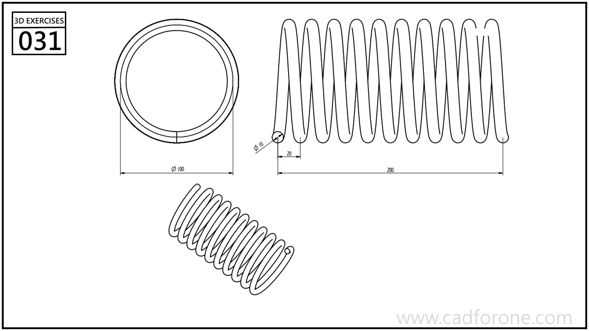

A straight cylindrical coil spring shown in end, side, and isometric views.

## Drawing reading checks

- Distinguish the coil diameter from the wire diameter when setting up the path.
- Check the total length and spacing of the turns against the side view.

## Check your result

- Compare the path, turn spacing, and end conditions with the drawing. Do not assume constant pitch or diameter where the views show a change.
