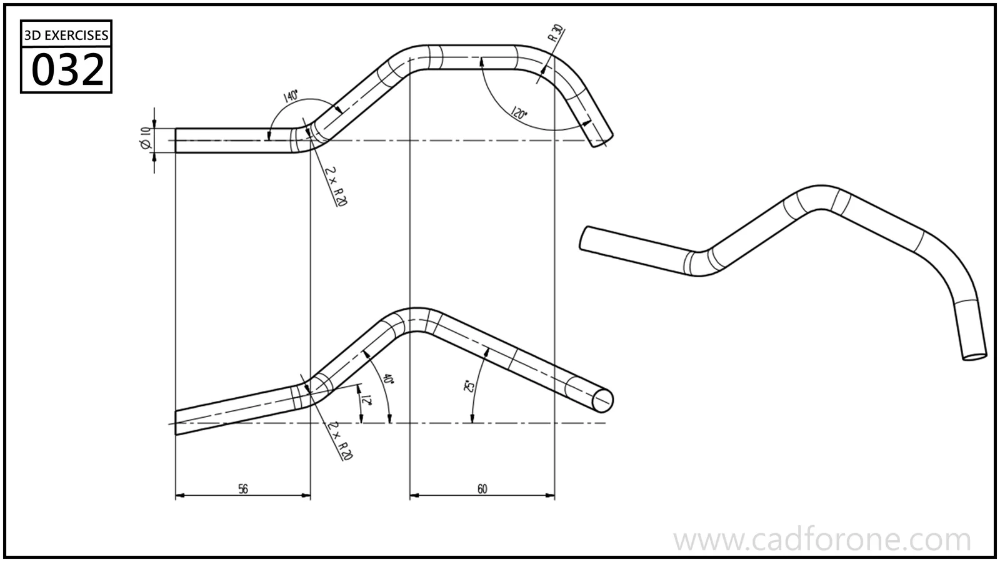

A bent strip following a spatial path with several rounded changes in direction.

## Drawing reading checks

- Combine the plan and elevation to locate bends that occur in different planes.
- Keep the strip section oriented consistently along the path and inspect each bend transition.
