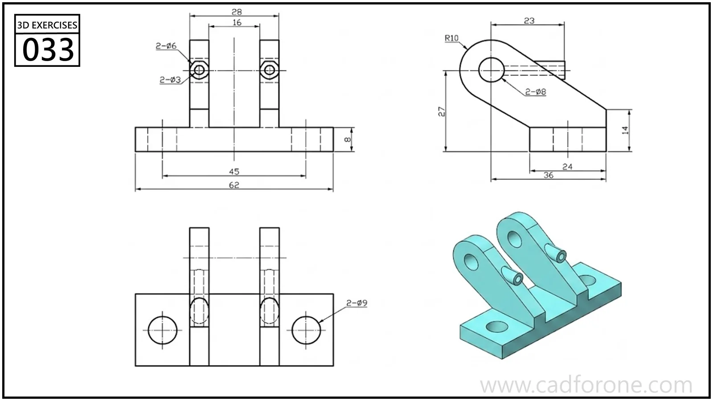

A base-mounted fork bracket with two inclined ears and aligned circular holes.

Practice notes

- Locate both ear holes on a common axis before forming the sloped supports.
- Check the central gap and base mounting holes against the plan view.

These are suggested reading checks, not a tested modeling tutorial.

