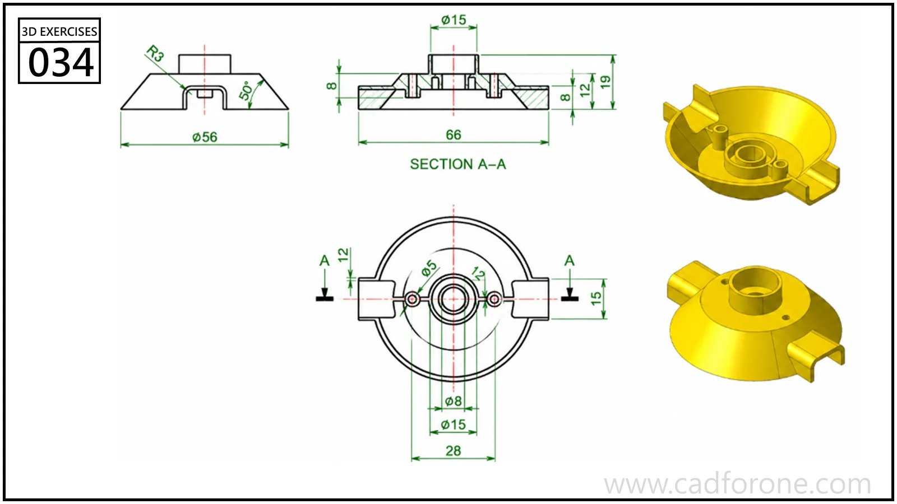

A shallow circular housing with a central bored boss, internal ribs, and two opposing tabs.

Practice notes

- Use section A-A to separate the thin shell from the central boss.
- Compare the upper and underside views when positioning the ribs and tabs.

These are suggested reading checks, not a tested modeling tutorial.

