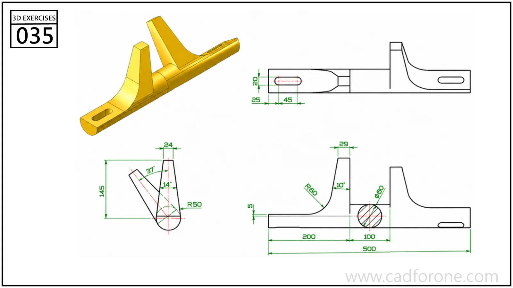

An elongated support with raised curved ribs and mounting slots near its ends.

Practice notes

- Establish the long base and end slots from the plan view.
- Use the side and end profiles to check the rib heights and curved transitions.

These are suggested reading checks, not a tested modeling tutorial.

