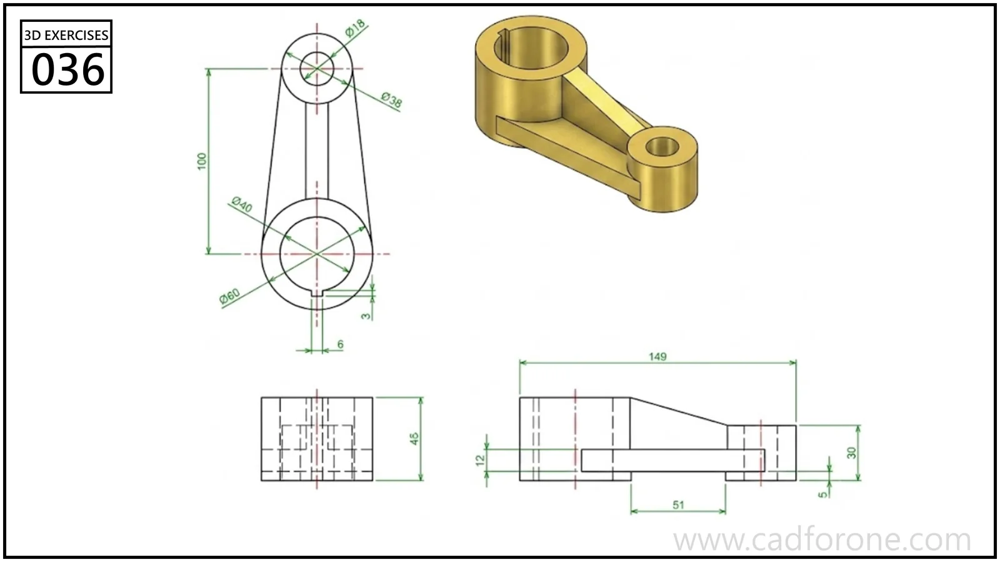

A connecting arm with two bored bosses of different sizes joined by tapered ribs.

## Drawing reading checks

- Place the boss centers and set their separate heights before joining them.
- Read the side view to check the rib taper instead of extruding the plan silhouette uniformly.

## Check your result

- Check each opening against the drawing: its size, center position, and direction must agree across the available views.
