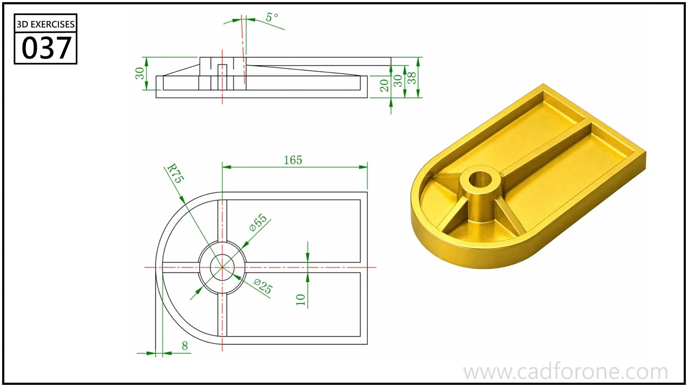

A rounded-end tray-like base with a central boss, a long rib, and smaller supporting webs.

Practice notes

- Set the outer wall and central boss from the section and plan.
- Check the longitudinal rib and radial webs against their distinct heights and directions.

These are suggested reading checks, not a tested modeling tutorial.

