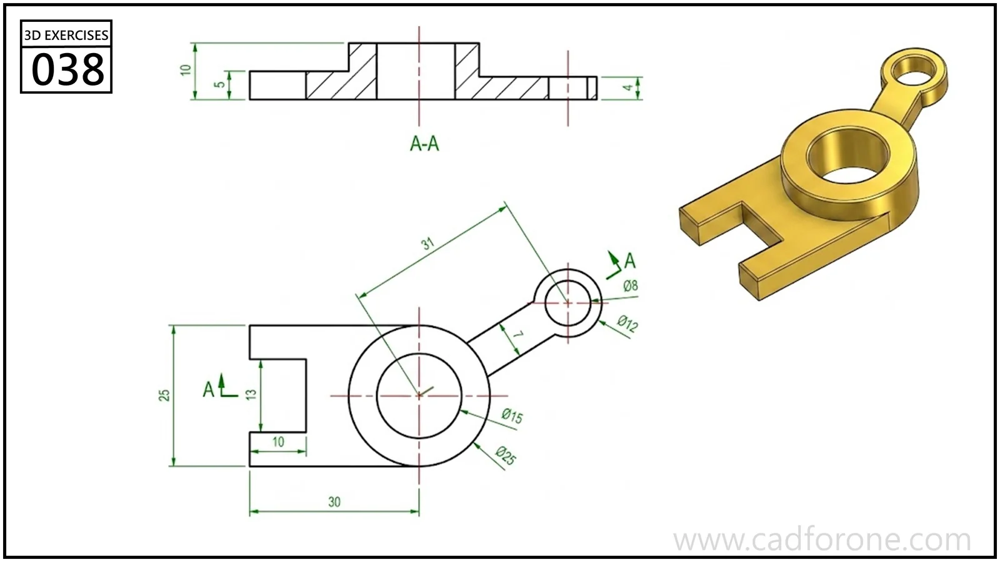

A fork-ended link with a raised central ring and a smaller eye on an angled arm.

Practice notes

- Use the section to establish the central boss height and bore.
- Locate the small eye on its angled centerline before opening the fork at the opposite end.

These are suggested reading checks, not a tested modeling tutorial.

