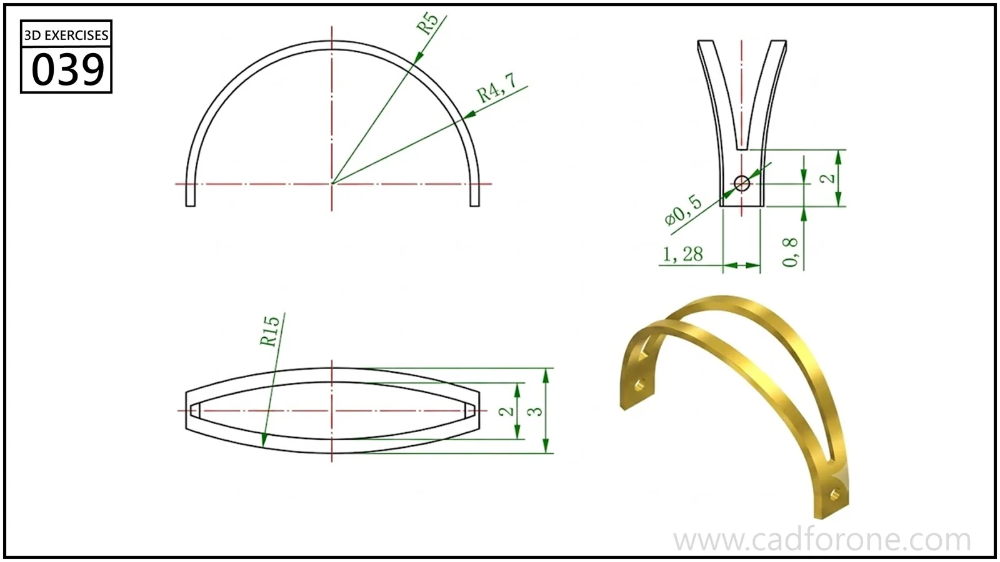

An arched strap with two slender curved bands joined near drilled end tabs.

## Drawing reading checks

- Use the plan view to establish the separation of the two bands.
- Compare the end view with the main arc to resolve their lateral curvature and end connections.

## Check your result

- Check each opening against the drawing: its size, center position, and direction must agree across the available views.
