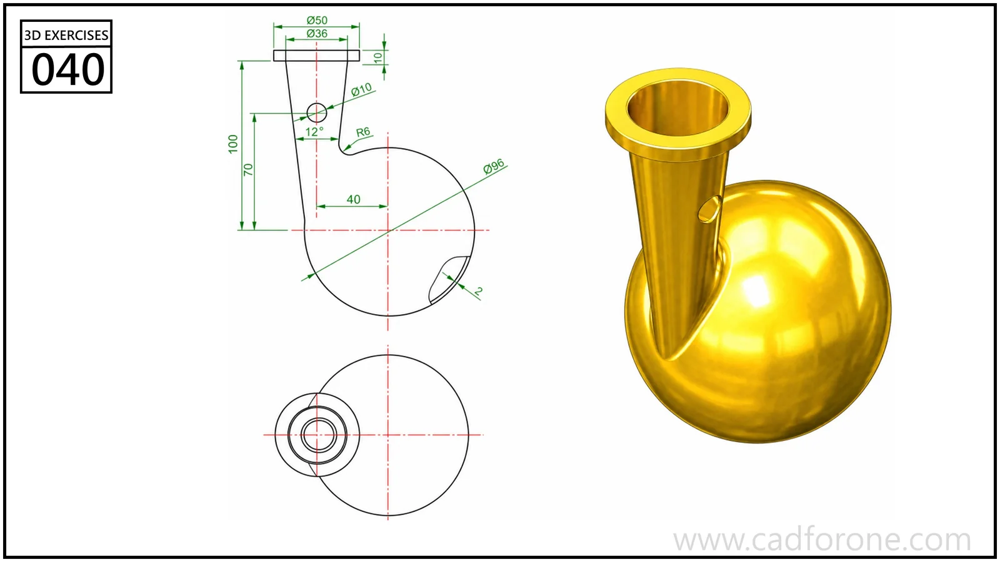

A hollow vessel with a spherical body and a tall, offset neck.

## Drawing reading checks

- Establish the sphere and neck axes before blending the two forms.
- Check the mouth and interior opening using the line views rather than the reflective rendering.

## Check your result

- Inspect the internal space as well as the outside shape. Use any section views to check which walls remain and where the passage opens.
