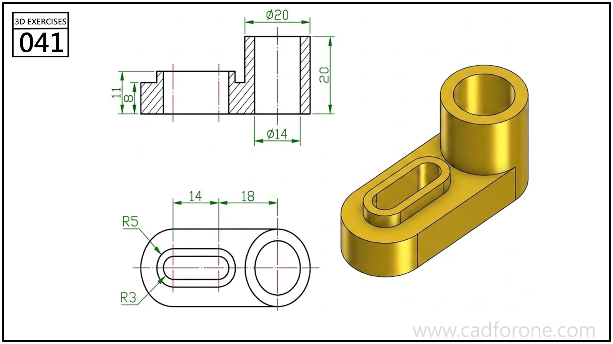

An oblong base with a tall cylindrical boss at one end and a raised slotted feature at the other.

## Drawing reading checks

- Use the section to establish the base thickness, boss height, and open bore.
- Check the oblong slot and its raised rim as separate contours.

## Check your result

- Check the slot ends and their center positions separately from the surrounding profile; confirm whether each slot is open-ended or enclosed.
