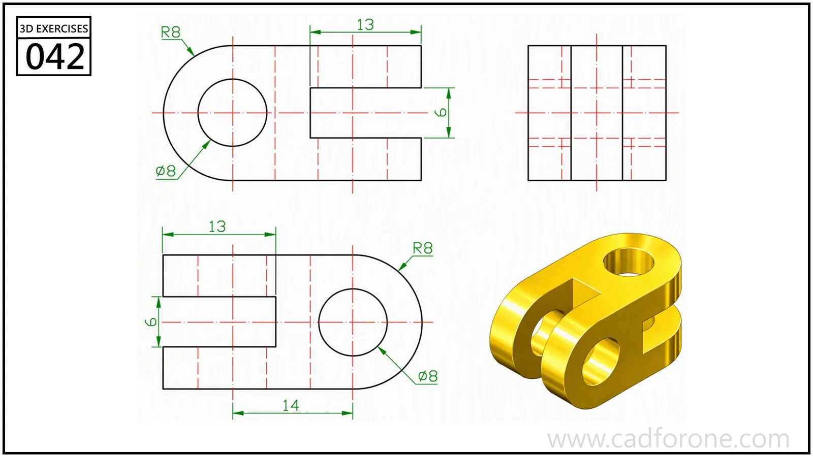

A compact forked link with rounded ends and intersecting hole directions.

## Drawing reading checks

- Compare the two principal views to resolve which end is forked in each direction.
- Check the gaps and hole axes before adding the rounded outside ends.

## Check your result

- Check each opening against the drawing: its size, center position, and direction must agree across the available views.
