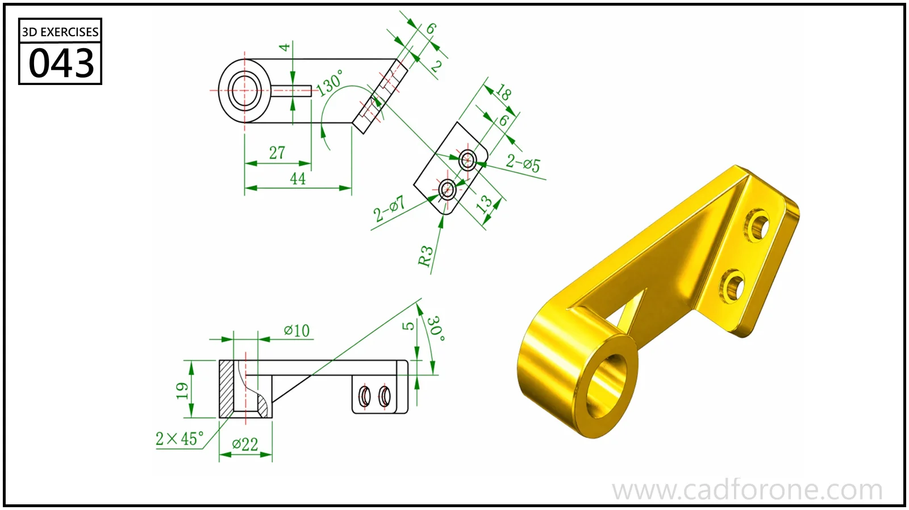

An inclined support arm joining a cylindrical eye to a two-hole mounting flange.

Practice notes

- Establish the eye axis and flange angle from the orthographic views.
- Check the triangular web opening and its surrounding thickness independently.

These are suggested reading checks, not a tested modeling tutorial.

