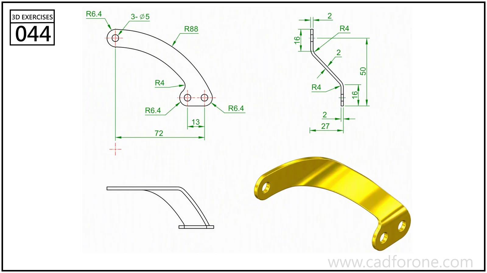

A curved strap with a stepped bend and drilled mounting ends.

## Drawing reading checks

- Use the plan view to shape the curved outline and locate its holes.
- Read the side profile to establish the offset between the two mounting ends.

## Check your result

- Check each opening against the drawing: its size, center position, and direction must agree across the available views.
