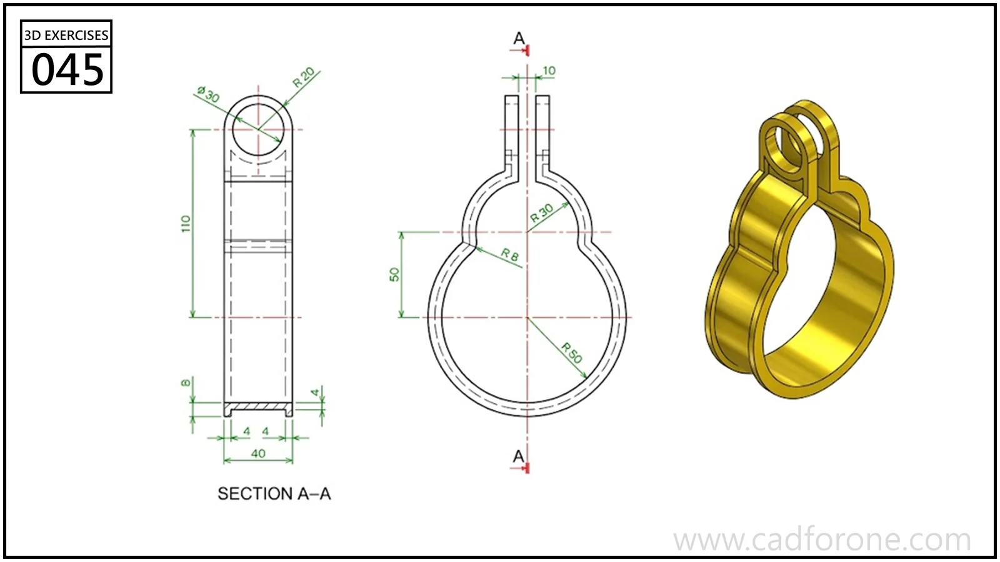

A split, rounded clamp band with two raised fastening ears.

Practice notes

- Use section A-A to trace the clamp's inner and outer profiles.
- Check the separation of the ears and the alignment of their fastening holes.

These are suggested reading checks, not a tested modeling tutorial.

