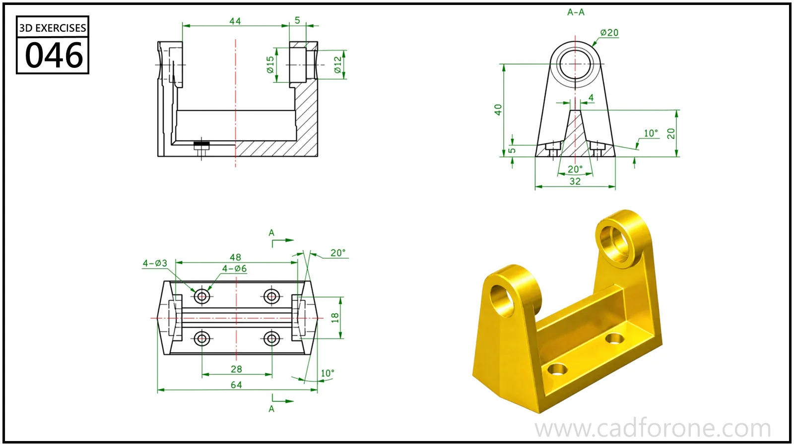

A U-shaped support with two bored uprights, reinforcing webs, and four base holes.

Practice notes

- Align the upright bores before shaping the tapered side supports.
- Use the section to check the base and webs, then locate the four mounting holes in plan.

These are suggested reading checks, not a tested modeling tutorial.

