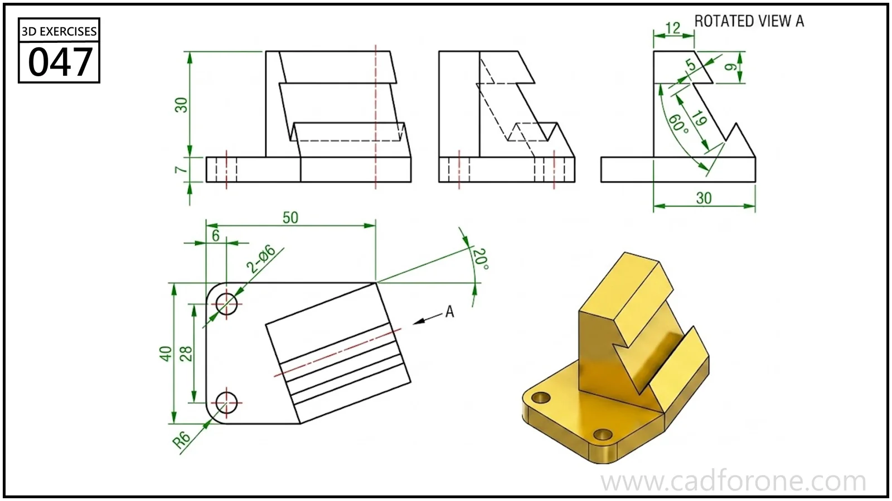

An angled, stepped support mounted on a rounded rectangular base.

## Drawing reading checks

- Use rotated view A to read the inclined feature in its own plane.
- Check the base-hole locations separately from the rotated upper profile.
