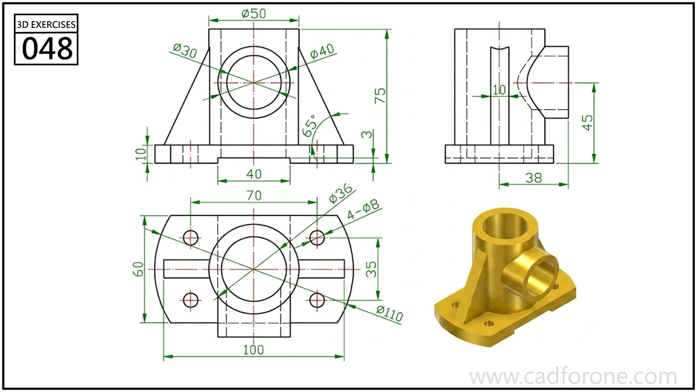

A ribbed mounting body with an upright bore and a transverse cylindrical feature.

## Drawing reading checks

- Locate the vertical and horizontal axes before constructing the surrounding body.
- Compare the side view and plan to resolve the internal openings and supporting ribs.

## Check your result

- Check each opening against the drawing: its size, center position, and direction must agree across the available views.
