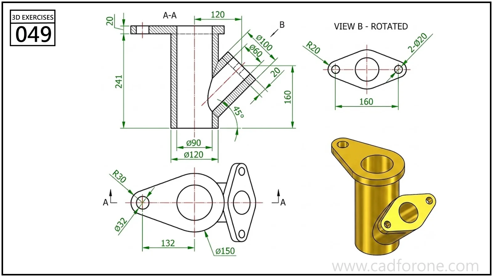

A hollow branch fitting with a straight main passage, an inclined outlet, and mounting flanges.

## Drawing reading checks

- Read section A-A to establish the passage walls and branch intersection.
- Use rotated view B to place the outlet flange holes in the flange plane.

## Check your result

- Inspect the internal space as well as the outside shape. Use any section views to check which walls remain and where the passage opens.
