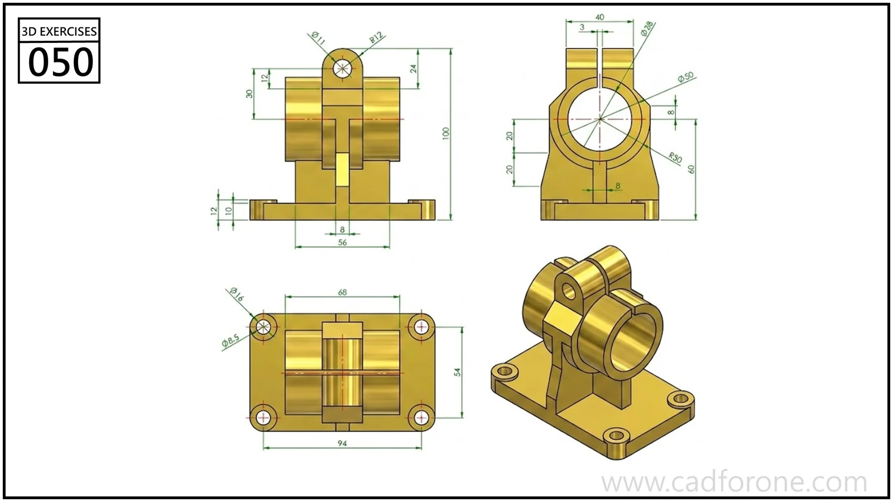

A base-mounted cylindrical housing with supporting ribs and a split upper fastening feature.

## Drawing reading checks

- Establish the main bore axis and base position before adding the supports.
- Compare all three views to resolve the upper split and fastening-hole direction.
