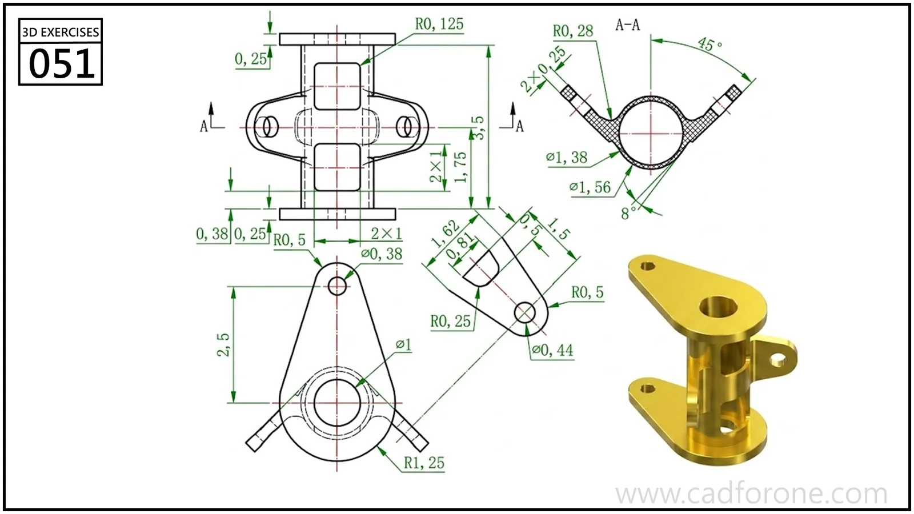

A tubular mounting body with end flanges and two angled side tabs.

Practice notes

- Use section A-A to establish the tube wall and side-tab angles.
- Check each flange and tab hole in its own view rather than projecting from the isometric image.

These are suggested reading checks, not a tested modeling tutorial.

