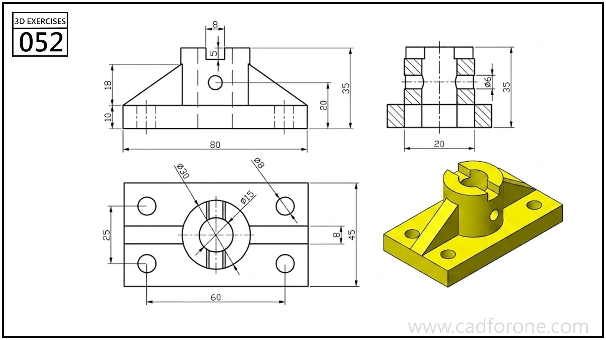

A rectangular mounting plate with a bored central boss, reinforcing ribs, and slots across the boss rim.

## Drawing reading checks

- Establish the bore and stepped boss from the section first.
- Check the rim slots and side hole separately from the reinforcing ribs.

## Check your result

- Check each opening against the drawing: its size, center position, and direction must agree across the available views.
- Check the slot ends and their center positions separately from the surrounding profile; confirm whether each slot is open-ended or enclosed.
