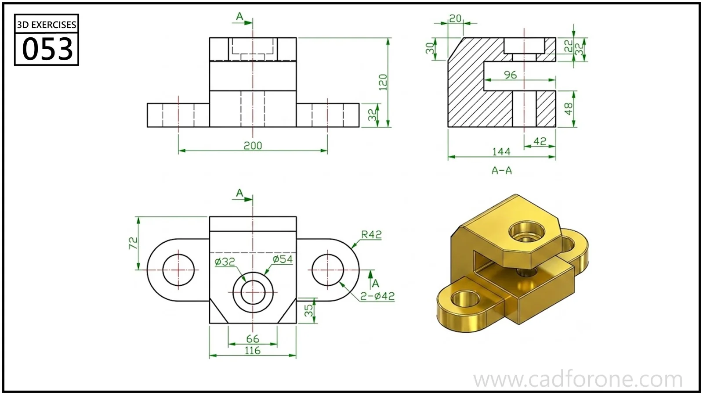

A forked mounting block with a vertical bore, horizontal gap, and two rounded mounting ears.

Practice notes

- Use section A-A to determine the depth of the gap and the bore steps.
- Locate the mounting ears from the plan view before shaping the upper block.

These are suggested reading checks, not a tested modeling tutorial.

