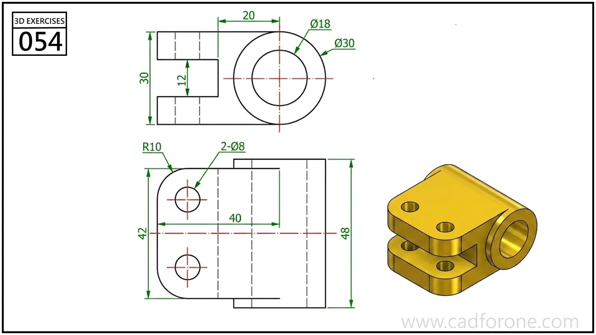

A clevis-style bracket with two parallel plates joined to a transverse cylindrical eye.

Practice notes

- Use the side view to establish the plate spacing and the round eye.
- Check which holes pass through the plates and which follow the transverse axis.

These are suggested reading checks, not a tested modeling tutorial.

