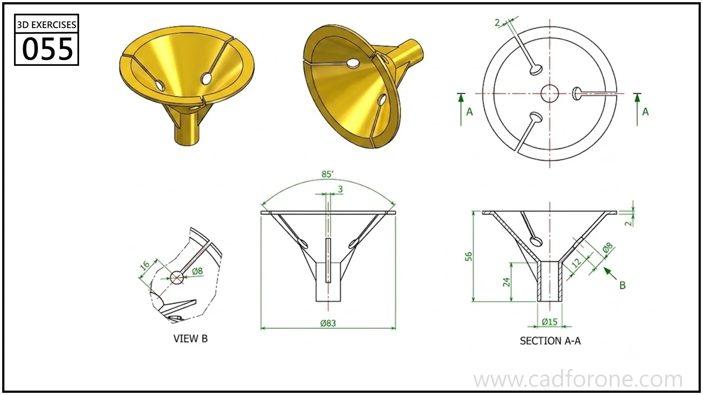

A conical funnel-like body with an outlet tube, wall openings, and internal reinforcing features.

## Drawing reading checks

- Use section A-A to establish the conical wall and outlet passage.
- Read the local view before repeating the openings around the cone.

## Check your result

- Check each opening against the drawing: its size, center position, and direction must agree across the available views.
- Inspect the internal space as well as the outside shape. Use any section views to check which walls remain and where the passage opens.
