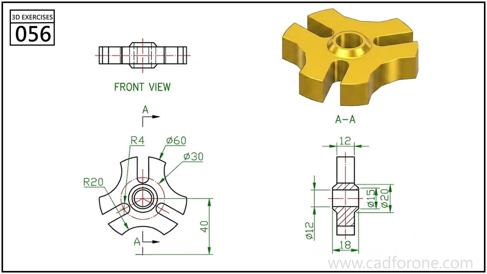

A three-armed hub with a central stepped bore and curved recesses between the arms.

Practice notes

- Establish the hub and bore from section A-A before forming one radial arm.
- Check the arm width and root radii before repeating the feature around the axis.

These are suggested reading checks, not a tested modeling tutorial.

