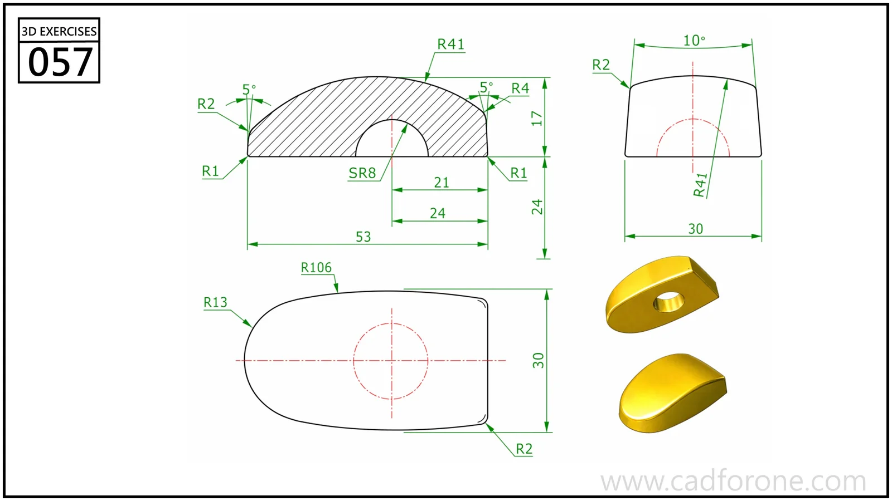

A low domed component with a rounded plan outline and an opening beneath the crown.

## Drawing reading checks

- Use the hatched section to distinguish the outer dome from the lower opening.
- Compare the plan and end views to resolve the taper and edge rounds.

## Check your result

- Check each opening against the drawing: its size, center position, and direction must agree across the available views.
