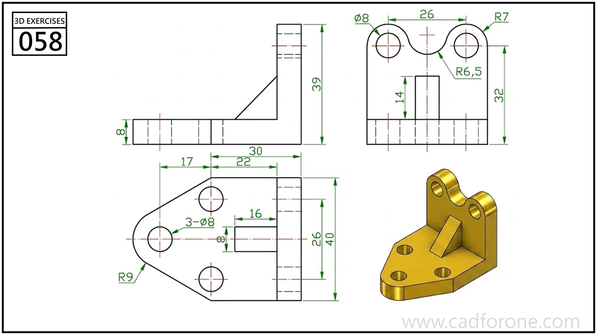

A ribbed angle bracket with two holes in its upright and three holes in its rounded base.

## Drawing reading checks

- Place the upright holes and the scalloped top from the front view.
- Check the central rib and base-hole layout against the side and plan views.

## Check your result

- Check each opening against the drawing: its size, center position, and direction must agree across the available views.
