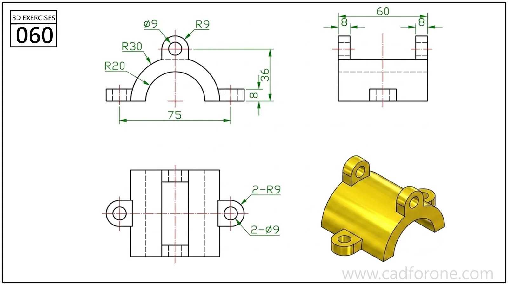

An arched saddle bracket with base feet and raised drilled ears.

Practice notes

- Establish the semicircular opening and outer arch from the end view.
- Use the plan view to place the feet and the separated fastening ears.

These are suggested reading checks, not a tested modeling tutorial.

