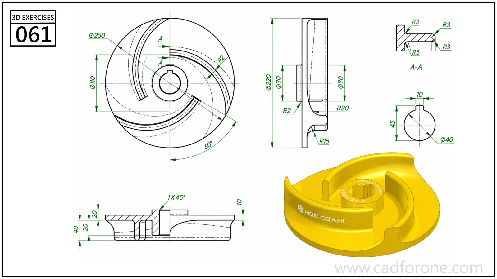

A circular impeller-like part with curved vanes, a central bore, and a recessed base.

## Drawing reading checks

- Use the sections to establish the base, hub, and vane heights.
- Construct one vane from its indicated curves before checking the repeated arrangement.

## Check your result

- Check each opening against the drawing: its size, center position, and direction must agree across the available views.
- Count the repeated elements and check their spacing about the center or along the path; a matching outline alone can hide a misplaced repetition.
