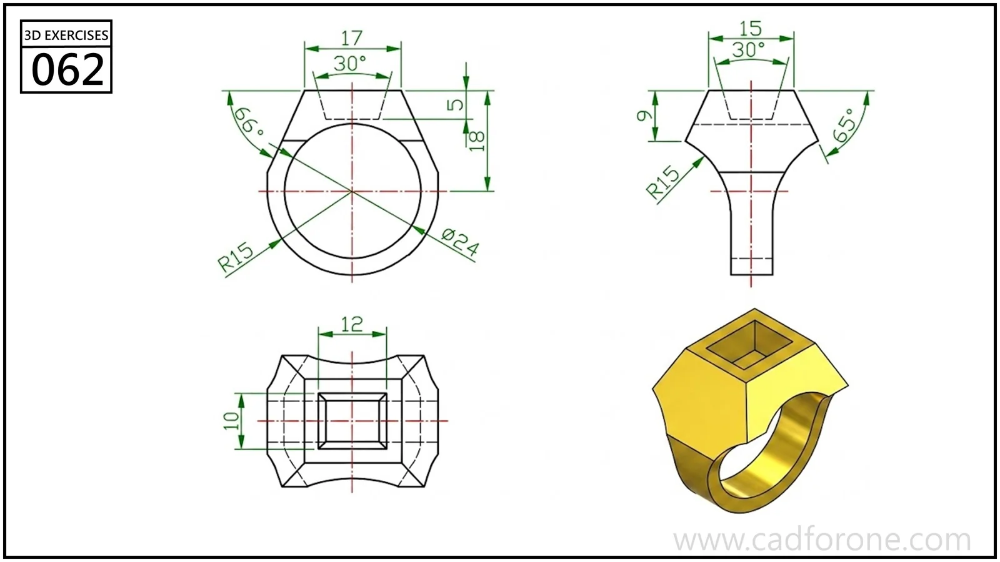

A ring-shaped form with a faceted upper body and a square recess on top.

Practice notes

- Establish the circular opening and the widening upper shoulders from the front view.
- Use the plan view to check the square recess and the surrounding facets.

These are suggested reading checks, not a tested modeling tutorial.

