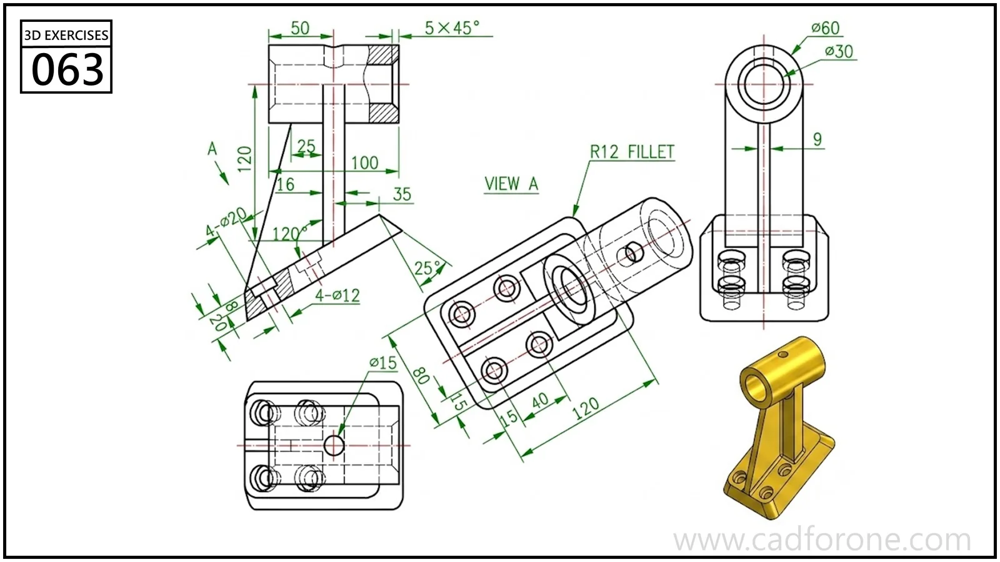

A tall ribbed support with a transverse top eye and a slotted mounting base.

## Drawing reading checks

- Locate the top bore axis relative to the base before forming the upright ribs.
- Use view A to read the slots and mounting holes without foreshortening.

## Check your result

- Check the slot ends and their center positions separately from the surrounding profile; confirm whether each slot is open-ended or enclosed.
