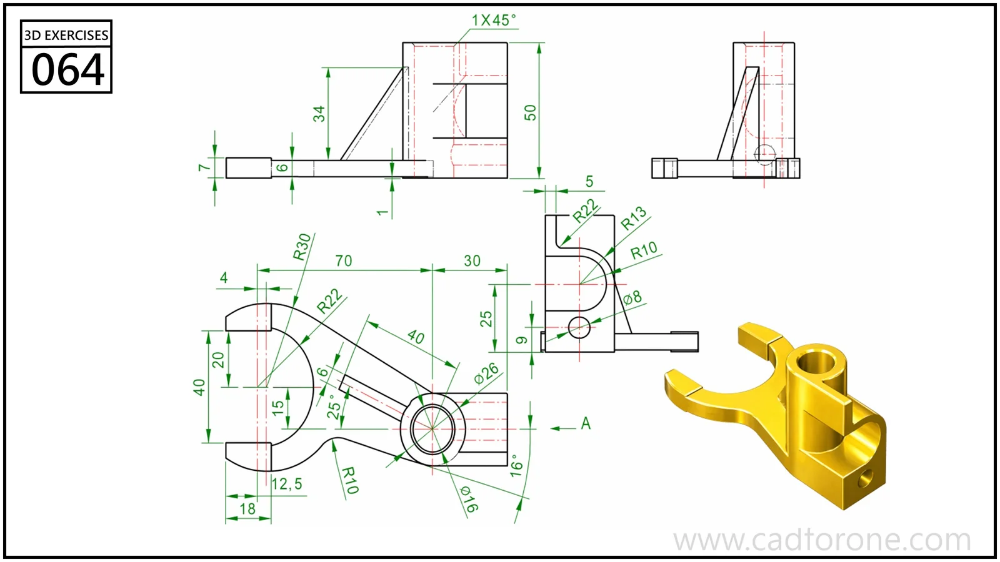

A forked support with a vertical cylindrical boss, a reinforcing web, and a raised end block.

Practice notes

- Establish the fork opening and boss location from the plan view.
- Use the side and end views to check the web height and end-block opening.

These are suggested reading checks, not a tested modeling tutorial.

