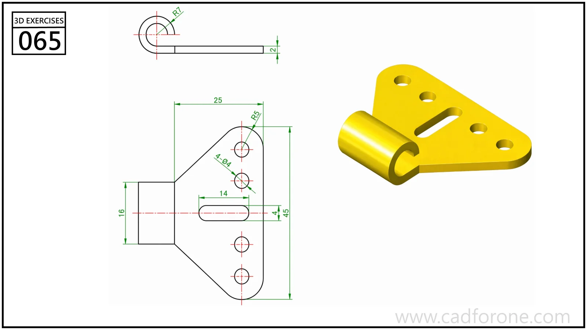

A triangular hinge leaf with mounting holes, an elongated slot, and a rolled edge.

## Drawing reading checks

- Lay out the flat leaf and openings before shaping the rolled barrel.
- Use the end profile to check the barrel radius and remaining opening.

## Check your result

- Check each opening against the drawing: its size, center position, and direction must agree across the available views.
- Check the slot ends and their center positions separately from the surrounding profile; confirm whether each slot is open-ended or enclosed.
