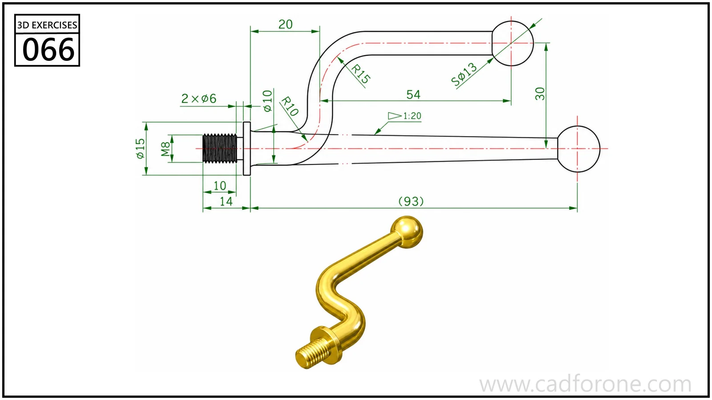

A bent handle with a threaded attachment end and a spherical knob.

Practice notes

- Construct the bent center path from the straight lengths and bend radii.
- Check the attachment direction and knob position against the reference views.

These are suggested reading checks, not a tested modeling tutorial.

