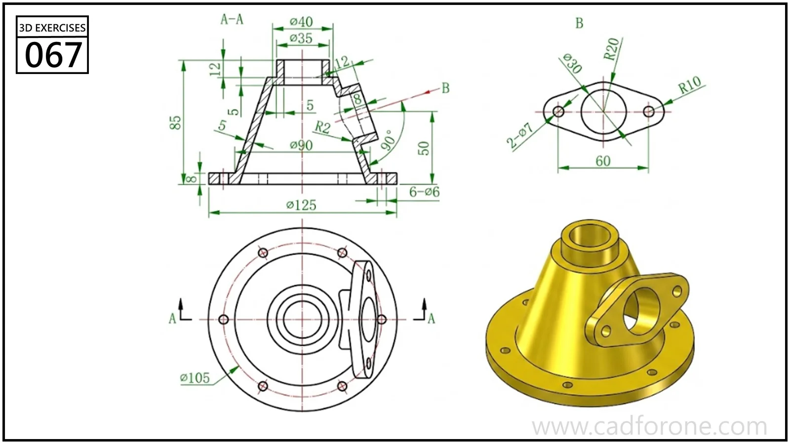

A tapered hollow housing with a circular base flange and an inclined side outlet.

## Drawing reading checks

- Use section A-A to establish the tapered wall and internal passages.
- Read the outlet view separately to locate its flange holes and orientation.

## Check your result

- Inspect the internal space as well as the outside shape. Use any section views to check which walls remain and where the passage opens.
