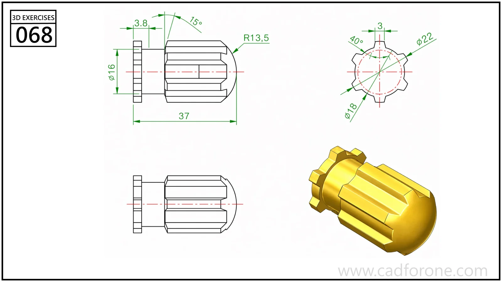

A fluted cylindrical knob with a rounded end and a toothed-looking base rim.

## Drawing reading checks

- Establish the axial profile before adding the repeated longitudinal flutes.
- Check the end view to distinguish the flute pattern from the base-rim pattern.
