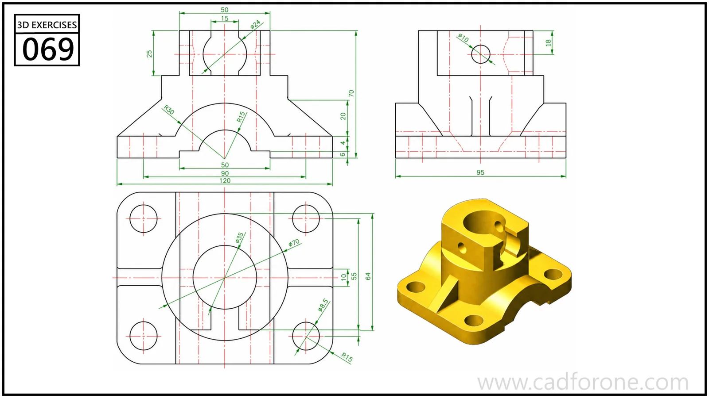

A ribbed mounting block with a bored split boss, four base holes, and an arched lower cutout.

Practice notes

- Resolve the lower cutout and boss bore from the orthographic views first.
- Check the boss slot and transverse hole independently from the base-hole pattern.

These are suggested reading checks, not a tested modeling tutorial.

