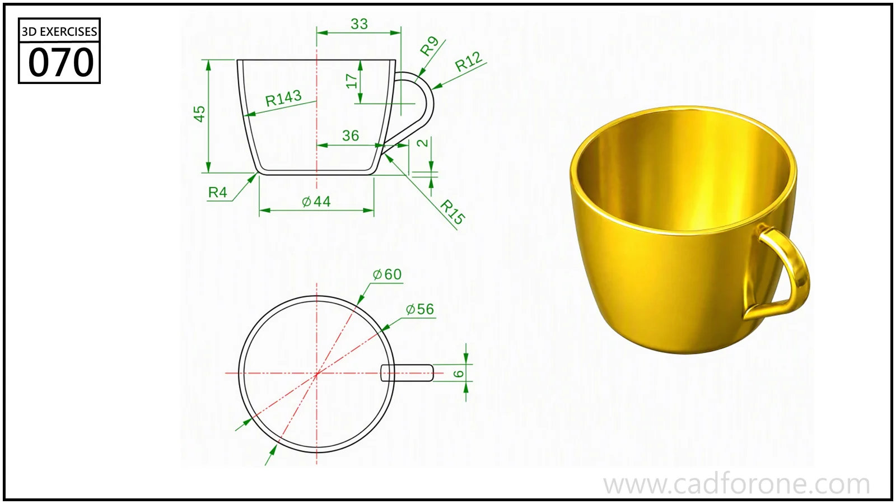

A tapered cup with a curved side profile and a small loop handle.

## Drawing reading checks

- Establish the inner and outer cup profiles before attaching the handle.
- Check the handle's upper and lower junctions against the side-view radii.
