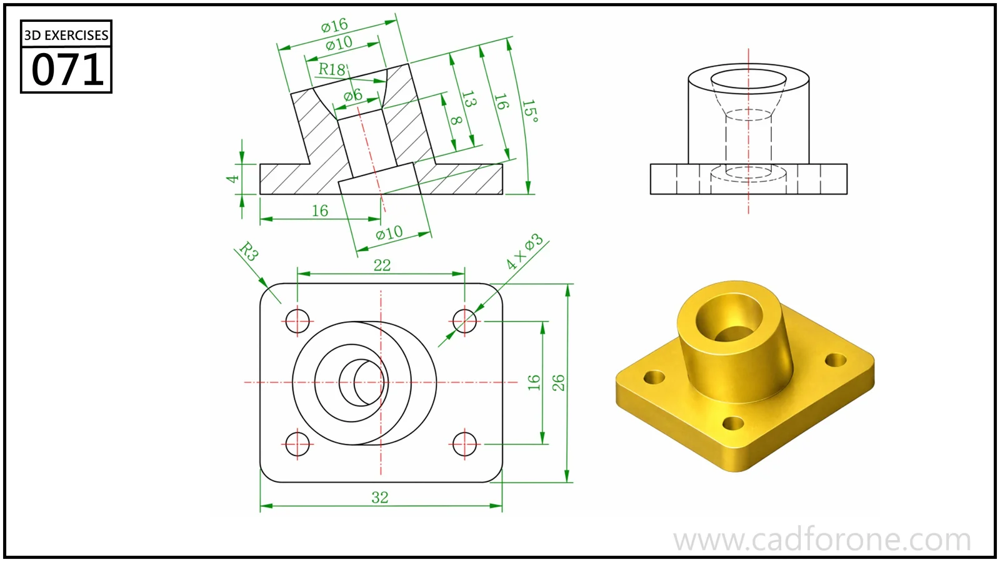

A rectangular mounting flange carrying an inclined hollow boss and four corner holes.

Practice notes

- Use the section to establish the boss angle, bore, and junction with the base.
- Check the four mounting-hole positions in plan independently from the tilted boss axis.

These are suggested reading checks, not a tested modeling tutorial.

