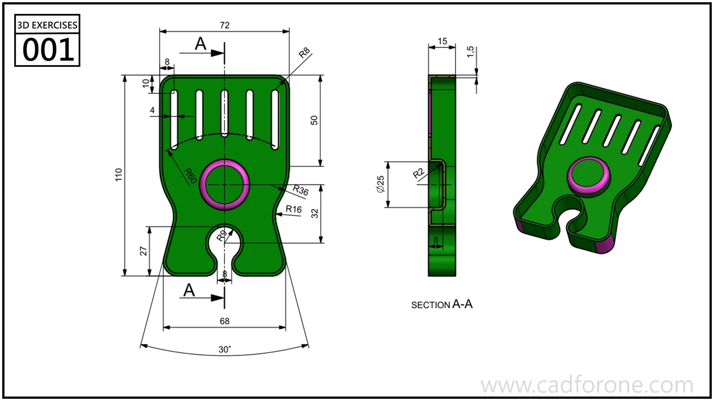

A thin-walled part with five upper slots, a circular feature, and a lower open cutout is shown in front, section, and isometric views.

Practice notes

- Read section A-A before deciding which side of the body is open.
- Compare the different slot lengths and the curved arrangement of their lower ends.

These are suggested reading checks, not a tested modeling tutorial.

